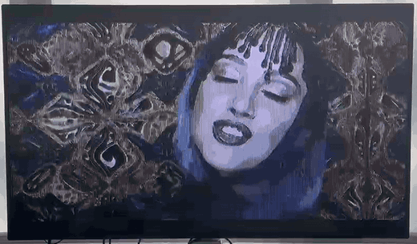

# FPGA Posterization Filter

Course: Reconfigurable Computing Design (CESE4090), TU Delft  
Authors (Group 4): Mingwu Liu, Sofie Vos, Hruday Ramachandra

A real-time posterization video filter for the PYNQ-Z2 FPGA platform. A custom
hardware accelerator is inserted into an HDMI video pipeline to apply a
cartoon-like posterization effect on 1280x720 video at 60 fps.

  
   
  <em>Live HDMI output from the board, filmed off the monitor.</em>

## What It Does

The filter flattens smooth gradients into bands of color while preserving strong
edges:
1. Convert RGB to grayscale and denoise for edge extraction.
2. Detect edges (Sobel) to build a binary edge map.
3. Blur the RGB channels and scale brightness.
4. Quantize each channel to a reduced number of levels.
5. Overlay the edge map: edges become black, other pixels keep quantized color.

## Results

| Before | After |
|:---:|:---:|
|  |  |

Input frame and the HLS filter's output from Vitis C simulation (Figure 6 in the report).

### Performance

1280x720 HDMI input, measured on the PYNQ-Z2 (60 fps budget: 16.67 ms/frame):

| Metric | Python (OpenCV on the ARM CPU) | FPGA accelerator |
|---|---:|---:|
| Mean latency | 1831.29 ms/frame | 16.77 ms/frame |
| Throughput | 0.55 fps | 59.64 fps |

About 109x lower mean latency than the software version. Python was timed over
200 frames (compute only); the FPGA over 2000 frames, timing each frame's read
and write through the HDMI pipeline.

### Resource Utilization

Whole design (HDMI video pipeline + filter IP) on the Zynq XC7Z020:

| Resource | Used | Available | Utilization |
|---|---:|---:|---:|
| Slice LUTs | 14,016 | 53,200 | 26.3% |
| Slice registers | 24,391 | 106,400 | 22.9% |
| Block RAM tiles | 16.5 | 140 | 11.8% |
| DSPs | 66 | 220 | 30.0% |

## Files

- `posterization_filter.cpp` — HLS source for the hardware accelerator.
- `posterization_filter.bit` — compiled FPGA bitstream.
- `posterization_filter.hwh` — Vivado hardware description file.
- `posterization_hardware_implementation_demonstration.ipynb` — hardware demo notebook.
- `python_algorithm_evaluation.ipynb` — CPU reference implementation and benchmark.
- `Reconfigurable_Computing_Design.pdf` — full project report.
- `images/` — figures used in this README.

## Platform

Xilinx Zynq-7000 SoC on the PYNQ-Z2 board: Python/Jupyter control from the ARM PS,
custom acceleration in the PL, AXI-Stream for the HDMI pixel flow, and AXI-Lite for
runtime parameters (edge threshold, brightness factor, quantization levels).

## Running the Demo

1. Copy `posterization_filter.bit` and the demo notebook to the PYNQ board.
2. Open `posterization_hardware_implementation_demonstration.ipynb` in Jupyter.
3. Load the overlay and set the filter registers (`edge_threshold`, `bright_factor`,
   `quant_levels`).
4. Start `hdmi_in` and `hdmi_out` to route the HDMI signal through the accelerator.
5. Run the benchmarking loop to measure per-frame latency and FPS.

The `python_algorithm_evaluation.ipynb` notebook provides a CPU-based reference
(OpenCV) for comparing software vs. FPGA-accelerated performance.
